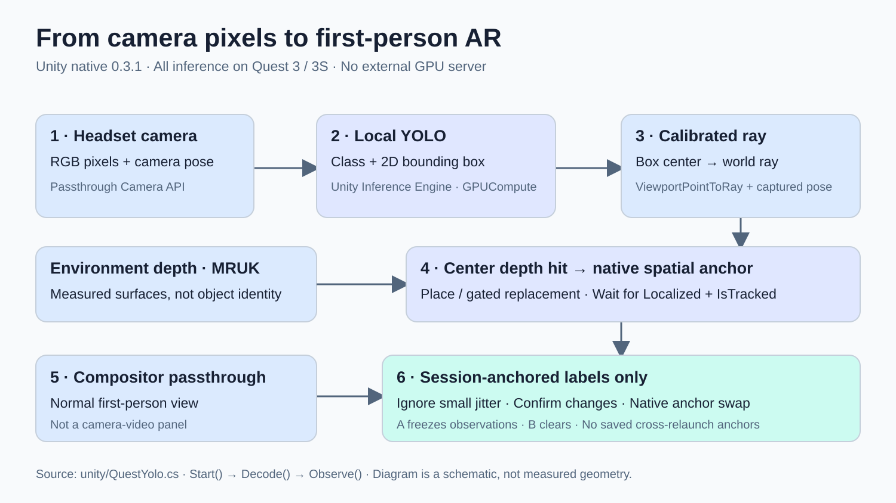
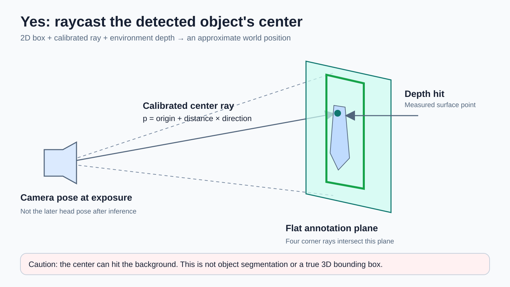

# Object detection → spatial AR / 物体検出から空間ARへ

**Teaching walkthrough · native 0.2.0 · 2026-10-20**

[ブラウザで読む / HTML tutorial](tutorial/index.html) · [実行手順](README.md) · [実機検証](VERIFICATION.md) · [ソース](unity/QuestYolo.cs)

> **Questの深度へ、検出した物体の中心からraycastできる？ → できます。現在のUnity版がこの方式です。**
> YOLOの2D矩形 → 校正済みカメラの中心ray → 環境深度上のhit point → world-space表示。
> これは物体の近似位置を求める処理で、継続した物体ID追跡や永続アンカーとは異なります。

## 1. What you see / 何が見えるか

Unity版はQuestの通常の一人称パススルー視界に、緑の枠と`chair` / `person`などのラベルを重ねます。カメラ映像を映す四角いパネルはありません。モデルにはカメラ画像が必要ですが、その画像をUIとして表示する必要はありません。

**検出用画像と表示用パススルーは別経路です。** Metaコンポジタが現実の視界を描画し、このアプリは線と文字のジオメトリだけを加えます。



編集可能な図: [pipeline.svg](tutorial/pipeline.svg) / [center-raycast.svg](tutorial/center-raycast.svg)。図は説明用の模式図です。実機画像ではありません。実機デモ動画は授業スライド／依頼者への配布素材を参照してください。元の部屋画像・録画・モデル重み・APKはこのGitリポジトリへ追加しません。

## 2. What runs where / 何を使ったか

| Layer | Native Unity implementation | Web implementation |
|---|---|---|
| Input | Meta Passthrough Camera API / Quest 3・3S | 読み取り可能な`getUserMedia`カメラ、ローカル画像・動画 |
| Detector | 同じ固定YOLOv9 ONNXモデル | 同じモデル |
| Inference | Unity Inference Engine 2.6.1 / 本体GPUCompute（CPU切替可） | ONNX Runtime Web 1.22.0 / WASM CPU |
| Spatial placement | MRUK 85.0.0 / EnvironmentRaycastManager | このWebサンプルには未実装 |
| Display | Unity OpenXR 1.16.1 / world-space線・文字 / compositor passthrough | Three.js 0.180.0 / WebXR内の映像パネル |
| Editor | Unity 6000.4.5f1でAndroid ARM64/IL2CPPビルド確認 | Vite 6.4.4 |
| External GPU | 不要 | 不要 |
| Headset acceptance | Unity 0.2.0 実機確認済み（下記の範囲） | Quest Browserでの実機確認は未実施 |

初期セットアップはSDK・モデルのダウンロードが必要です。Unityアプリの推論は端末内で完結し、外部推論サーバーや`adb reverse`を使いません。「外部GPU不要」は「GPUを一切使わない」ではなく、**Questの内蔵GPUで動く**という意味です。

WebXRでパススルーが見えることは、JavaScriptがその画素や深度を取得できることと同義ではありません。Raw Camera Access仕様の存在だけでQuest Browser対応を保証しません。このWeb版はUnity版と同等の物体位置合わせではありません。

## 3. Center raycast / 2Dの矩形から3Dの近似位置へ



1. YOLOが640×640画像上に`class, score, x, y, width, height`を出します。ここに3D位置はありません。
2. 検出矩形を正規化し、画像の上原点とUnity viewportの下原点の違いを補正します。
3. 中心UVを`ViewportPointToRay(uv, capturedPose)`へ渡します。FOVや正面固定距離を手で仮定しません。
4. `EnvironmentRaycastManager.Raycast`で環境深度を照会します。ヒット点が世界座標の近似物体位置になります。
5. ヒット点を通り、撮影時のカメラに平行な平面を作ります。四隅のrayとその平面との交点を線で囲みます。
6. hitなし、距離範囲外、tracking喪失などのときは表示しません。

### Exact implementation / 実装抜粋

下記は[QuestYolo.csのDrawメソッド](unity/QuestYolo.cs)からの抜粋です。変数`b`は正規化済みの検出矩形です。

```csharp
float left = Mathf.Clamp01(b.x), right = Mathf.Clamp01(b.x + b.w);
float bottom = Mathf.Clamp01(1 - b.y - b.h), top = Mathf.Clamp01(1 - b.y);
var ray = cameraAccess.ViewportPointToRay(
    new Vector2((left+right)/2, (bottom+top)/2), capturedPose);
if (!environmentRaycast.Raycast(ray, out var hit, 12f)) continue;
float distance = Vector3.Distance(capturedPose.position, hit.point);
if (distance < .25f || distance > 12) continue;
var plane = new Plane(capturedPose.rotation * Vector3.forward, hit.point);
```

カメラ画像の取り込み前に撮影時姿勢を保存しています。推論完了後の頭の姿勢で古い画像を投影すると、頭の動きに伴うずれが増えるためです。

```csharp
capturedPose = cameraAccess.GetCameraPose();
Graphics.Blit(cameraAccess.GetTexture(), snapshot);
```

[完全な処理](unity/QuestYolo.cs): `Start()`画像取得・推論 → `Decode()`閾値とクラス別NMS → `Draw()`raycast・world-space描画 → `Update()`有効期限・tracking確認。

### Why the center is not always the object

椅子の穴・人の脚の間・物体が重なる部分などでは、矩形中心が背景を指します。深度は「この画素方向にある表面の距離」であり、物体クラスや所有関係を返しません。単一rayは物体中心や3D寸法を保証しません。

**拡張候補（現版に未実装）**: 矩形内部の複数rayをサンプルし、有効深度を外れ値除去 → 中央値／手前のクラスタを採用。さらにセグメンテーションマスクで背景を除外。ただし誤った物体IDや遮蔽は別途扱う必要があります。

## 4. Detection ≠ tracking ≠ anchors

| Concept | Meaning | Current 0.2.0 |
|---|---|---|
| 2D detection / 検出 | この画像に何がどこにあるか | 実装済み: YOLOクラス・矩形 |
| 3D localization / 位置推定 | この検出を世界のどこへ表示するか | 実装済み: 中心ray + 深度の近似 |
| Temporal object tracking / 物体追跡 | 時間をまたいで同じ物体に同じIDを割り当てる | **未実装**。検出ごとに描き直す |
| Head tracking / 頭部追跡 | ヘッドセットの位置・向きを求める | Metaの位置追跡を利用。物体IDではない |
| Persistent anchor / 永続アンカー | 再起動後にも同じ実世界位置へ戻す | **未実装**。保存・共有なし |
| Digital twin / デジタルツイン | 物体・形状・状態を継続管理するモデル | このサンプル単独では未達成 |

現在は1回ずつ非同期推論し、毎回world-spaceの線とラベルを作り直します。要求上限は既定5Hzですが、実行時間によって実更新は遅くなります。**5Hz設定は5FPS保証でもXR描画FPSでもありません。** 更新が0.85秒以上途絶えると枠を消します。

「XR object」を作る次の段階では、`trackId, class, position, confidence, lastSeen`を持つ状態モデルを作り、前回の3D位置・クラス・2D矩形との対応付けを行います。物体に追従する動的trackと、空間に固定するanchorは別設計です。これは今後の拡張案であり、現版の動作実績ではありません。

## XR-Objectsとのつながり / Augmented Object Intelligence

ここでいう**XR-Objects**は、[Dogan et al., UIST 2024: Augmented Object Intelligence with XR-Objects](https://xr-objects.github.io/)（[DOI](https://doi.org/10.1145/3654777.3676379)）です。一般的な「XRのGameObject」ではありません。

論文のFigure 4・§3.3（PDF pp.5–7）の構成は、**物体検出 → 深度raycastで3D位置 → object proxy → オブジェクトに結び付いたcontext menu → 情報取得・比較・共有・ノート／タイマー**です。実装はスマートフォンのUnity AR Foundation / ARCore、MediaPipeのCOCO80検出、クラウドのPaLI MLLMを組み合わせています。論文のスマートフォン実装は、Questで全部ローカルに動いた証拠ではありません。

| Stage | XR-Objects paper | This Quest sample |
|---|---|---|
| Find | MediaPipe detector | Local YOLO |
| Localize | ARCore depth + raycast | MRUK environment depth + center ray |
| Present | Object proxy + contextual menu | World-space outlines + class labels |
| Act / reason | Information, compare, share, anchor widgets / cloud PaLI | **未実装**: 選択UI、メニュー、物体別会話・クラウド推論はない |

したがって現在のQuest版は、XR-Objectsへ向けた**検出・位置合わせの足場**です。中心rayのhit位置にPrefabを置き、controller/hand rayで選択し、物体に結び付いたメニューを開く、という拡張は可能です。ただし0.2.0はそのインタラクションを実装・検証した完成版ではありません。単なる`chair`ラベルから製品名・使い方・質問応答が得られるわけでもありません。

## 5. Reproduce / 再現する

### Unity — recommended for first-person AR

```bash
# digital-twin のルートで実行。出力先はまだ存在しない場所にする。
python3 implementations/quest-ondevice-yolo/scripts/prepare-unity.py /absolute/new/quest-yolo-unity
```

Git LFSとUnity HubのAndroid Build Support（SDK/NDK/OpenJDK）が必要です。スクリプトはMeta公式プロジェクトのコミット`3baac1a1a53aa00af3f639425914f14238a97f84`を取得し、モデルSHA256を検査します。

1. Unity **6000.4.5f1**で生成先を開きます。
2. `Classroom > Prepare YOLO scene`を実行します。
3. `Classroom > Build Android APK`でビルドします。
4. APKをQuest 3/3Sへ導入します。既存実機確認版のpackageは`org.openclaw.classroom.yolo`、versionは`0.2.0/code3`です。
5. カメラ・空間データの許可を行い、位置追跡が成立した状態で`Classroom Local YOLO`を開きます。
6. 普通のパススルー視界に緑の線とラベルが出ることを確認します。カメラパネルはありません。

生成シーン、権限・Prefabの設定は[ClassroomBuild.cs](unity/Editor/ClassroomBuild.cs)、固定取得手順は[prepare-unity.py](scripts/prepare-unity.py)を参照してください。QuestのカメラAPI対象はQuest 3/3Sです。PCAの公式最低条件と、今回実際にビルド確認したSDKバージョンは同じものではありません。

### Web — detection introduction, not equivalent spatial placement

```bash
cd implementations/quest-ondevice-yolo/web
npm ci
npm run prepare-assets
npm test
npm run dev
```

まずPCでLoad model → カメラまたはローカル画像 → 検出を試します。Questへ配る場合は信頼されたHTTPSが必要です。WebXRは映像パネル表示で、ブラウザの実カメラ可否も実行時の許可結果に依存します。詳細は[README](README.md#web版)。

## 6. What was actually tested / 実機で確認した範囲

[VERIFICATION.md](VERIFICATION.md)が測定の一次記録です。**0.2.0（2026-10-20）の静止Quest 3**では:

- 実カメラ → 本体GPUCompute → 一人称の線・ラベル表示を確認。
- 新しいプロセスで122推論サンプル。中央値**271.61ms/回**。
- 121/122回で深度付きの表示が3–5件。起動直後の1回は0件。
- 約14.95秒の実コンポジタ録画の最初・中間・最後を目視確認。カメラパネルはなく、人・椅子・ノートPCのラベル・枠が見えます。

**121/122は検出精度ではありません。** 各推論で深度付きannotationが出た回数であり、正解物体との精度評価ではありません。271.61msは推論から表示更新までの処理指標で、XR表示FPSではありません。

未検証: 頭を動かした際の位置ずれの定量評価、物理Aボタン操作、長時間の熱・バッテリー、USBを物理的に外した試験、Quest Browser/WebXR実機。0.1.1のカメラパネル版の中央値275.27msとは別の測定です。

## 7. Classroom exercises / 授業での実験

1. **Detect**: 椅子・人などを検出し、threshold 0.35と0.6を比較する。
2. **Localize**: 中心rayのヒット点を確認し、椅子の穴など背景に当たる例を探す。
3. **Explain**: なぜ2D矩形の四隅から本物の3D形状は得られないか説明する。
4. **Measure**: `QUEST_YOLO ... inference_ms=... depth_hits=... tracked=...`ログを使う。表示FPSと混同しない。
5. **Extend**: 複数rayの深度集約を追加する。動的物体ID追跡・永続アンカーは別の課題として設計する。

## Lecture slides / 授業スライドと再利用

[授業スライド — Quest implementation extension](https://docs.google.com/presentation/d/1cSDat0MuJk7qmj2TtbPbHt5IGeLQUsle8kemzN639hY/edit#slide=id.quest_lab_section)

既存37枚の後ろへ追加した13枚（38–50）の構成です。実機の静止画とDrive動画は授業スライド側に置き、このGitには元の部屋画像・録画を再配布しません。

| Slide | Topic |
|---|---|
| 38 | Build it: object-aware AR — implementation section |
| 39 | Recognize objects in first person — actual demo frame |
| 40 | Demo: on-headset inference — actual device video |
| 41 | From labels to XR-Objects — object-bound interaction goal |
| 42 | Detection is not yet tracking — capability distinctions |
| 43 | How it runs on the headset — processing pipeline |
| 44 | A ray turns a pixel into a 3D point — projection geometry |
| 45 | What we used — pinned software stack |
| 46 | The center-ray step in code — source excerpt |
| 47 | Unity native versus WebXR — current capabilities |
| 48 | What the real-device test shows — measured acceptance |
| 49 | Next: make each object actionable — unimplemented extensions |
| 50 | Try it, then change one layer — classroom exercise |

[slides.json](tutorial/slides.json)にスライドID・順序・見出し・技術上の注記を保存しています。[compose-slides.py](tutorial/compose-slides.py)はネイティブなGoogle Slides図形・テキスト・Drive画像／動画の生成レシピです。画像・動画の画素や認証情報は含みません。レシピはこの授業テンプレートのlayout/placeholder IDを使用します。任意の空スライドへそのまま適用する汎用ツールではありません。

### Safe dry-run / APIへ書かずに再生成

1. 自分が利用を許可されたDrive画像・動画を用意し、`media.json`を作ります。形式は`[{"id":"IMAGE_DRIVE_ID"},{"id":"VIDEO_DRIVE_ID"}]`です。アクセス権の変更や素材のアップロードはこのレシピでは行いません。
2. 未作成の作業フォルダを指定して実行します（標準ライブラリのみ、認証不要）。

```bash
python3 implementations/quest-ondevice-yolo/tutorial/compose-slides.py \
  --presentation-id YOUR_TEMPLATE_COPY_ID \
  --media-json /absolute/media.json \
  --work-dir /absolute/new/quest-slide-plan
```

`manifest.json`と`requests.json`が生成されます。既定ではGoogle APIを一切呼びません。実際に反映する場合のみ、元の37枚構成を保つ授業テンプレートの**コピー**と、利用者側で認証済みの`google_api.py` helper（`Google().presentation(id)`と`Google().batch(id, requests)`を実装）を用意し、新しい作業フォルダ・`--google-helper-dir /absolute/helper-directory --apply`を指定します。

元の完成済み授業スライドには再適用しないでください。13枚は既に存在し、ID重複／37枚チェックにより中断します。適用は複数バッチで行うため、途中失敗したコピーには盲目的に再実行せず、部分適用を確認して新しいコピーでやり直します。認証の読み込み・トークン取得・保存ロジックは利用者のhelperに分離してあり、このソースには含めません。

## Sources / 参照

- [XR-Objects: project and paper](https://xr-objects.github.io/) — UIST 2024, DOI 10.1145/3654777.3676379, Figure 4 / §3.3, pp.5–7.
- [固定Meta公式ソース](https://github.com/oculus-samples/Unity-PassthroughCameraApiSamples/tree/3baac1a1a53aa00af3f639425914f14238a97f84)
- [Meta Passthrough Camera API](https://developers.meta.com/horizon/documentation/unity/unity-pca-overview)
- [Meta Unity推論統合](https://developers.meta.com/horizon/documentation/unity/unity-pca-sentis)
- [WebXR Raw Camera Access仕様](https://immersive-web.github.io/raw-camera-access/)
- このリポジトリの[Unity処理](unity/QuestYolo.cs)、[シーン生成](unity/Editor/ClassroomBuild.cs)、[Web処理](web/src/yolo.js)、[検証](VERIFICATION.md)。

Publication scope: implementation teaching sources and original schematic figures only. No room media, private transcripts, credentials, SDK binaries or model weights. Integration target: `origin/main`; completion owner: Quest classroom tutorial task. Authoritative tutorial paths: this file, `tutorial/`, and tutorial links in the implementation/root README. Existing runtime code and imported snapshots are unchanged.
